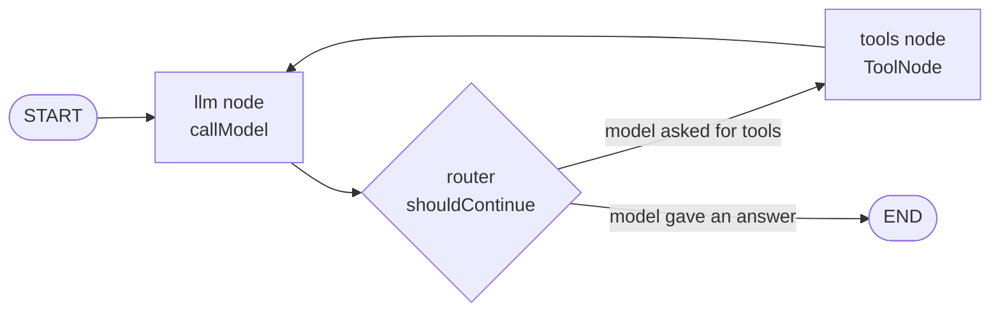

# LangGraph Agent: Specification

> Learn **LangGraph.js** by building one agent with it, and watching it work. This is about LangGraph itself: state, nodes, edges, reducers, streaming modes, checkpoints, time travel, interrupts and fan-out. Companion to [`SPEC-AGENT.md`](../SPEC-AGENT.md) (the hand-built agent) and [`AGENT-NOTES.md`](./AGENT-NOTES.md) (what we measured).

| | |
|---|---|
| **Status** | Draft v0.6, 2026-10-19. **Phases 1 to 3 are done** (graph fundamentals; state and reducers; tool calling and agent loops); Phase 4 (persistence and memory) is next |
| **Owner** | Aditya Dey |
| **Primary goal** | **Understand how LangGraph works** by using each of its core ideas in a real agent, with every step visible in a terminal. |
| **Interface** | A command line and tests. **No SSE, no HTTP route, no browser UI.** |
| **Not a goal** | Replacing the hand-built agent, or integrating with the web app. |

### What changed in v0.6

**Phase 3 (tool calling and agent loops) is done.** The ready-made `ToolNode` was replaced once by a hand-written tools node (`runTools` in `tool-node.ts`) so the failure handling is visible: a failing tool, invalid arguments or an unknown tool name all become an error message the model can read and recover from. A new `toolErrors` state field counts failures, and when it reaches 3 the graph goes to a `giveUp` node instead of back to the model. `runAgent` now catches the recursion limit and returns a friendly message. The practical task and the real runs are recorded in section 10.

### What changed in v0.5

**Phase 2 (state and reducers) is done.** The agent now has a real state, `AgentState` in `state.ts`: the messages plus three fields with different reducers (`searchCount` adds, `searchQueries` joins, `lastAnswer` replaces). `agent.ts` returns updates for them and logs the state (`· state:` lines), and `tests/test-state.ts` checks each reducer. An earlier stream-based trace script was removed because streaming is a later topic (Phase 6).

### What changed in v0.4

The roadmap (section 10) is now the **eight-phase learning path**: Phase 1 graph fundamentals, 2 state and reducers, 3 tool calling and agent loops, 4 persistence and memory, 5 human-in-the-loop, 6 streaming and observability, 7 advanced graph patterns, 8 production-ready agents. It replaces the earlier L0 to L8 implementation table, and every reference elsewhere in this document now points at a phase. Phase 1 is complete and its practical task (three traced runs) is recorded in section 10.

### What changed in v0.3

**LangGraph lives in its own self-contained folder, `src/langgraph/`, and imports nothing from the rest of the project.** Code that the hand-built agent also has (the five tools, the system prompt, the document search, the calculator) is **duplicated** into that folder on purpose. The goal is a clean, easy-to-follow structure where everything about LangGraph is in one place, even though some code exists twice. A test enforces it: it fails if any file in `src/langgraph/` imports from outside the folder.

### What changed in v0.2

v0.1 made LangGraph a second engine behind the existing SSE endpoint and UI, with the same event stream. That is dropped:

- No `engine` request field, no change to `app/api/agent/route.ts`, no UI toggle, no `AgentEvent` adapter, no SSE reuse.
- No Next.js bundling work (nothing in `app/` imports LangGraph).
- LangGraph's **own** streaming (`values`, `updates`, `messages`, `custom`) is studied directly instead of being translated into our events.
- Added what makes graphs distinctive and was previously a footnote: **checkpoints, state history, replay, forking, diagrams, and fan-out with `Send`**.

---

## 1. Purpose

LangGraph describes an agent as a **graph**: nodes (steps) joined by edges (what runs next), reading and writing shared **state**. The hand-built agent in `src/lib/agent/loop.ts` does the same job with a `for` loop. Building the same agent in LangGraph shows, concretely:

- what a graph gives you for free (structure, parallel branches, checkpoints, pause and resume, a diagram),
- what you still write yourself (budgets, a forced final answer, a repeat guard, citation checks),
- what it costs (a dependency, indirection, a different way of thinking about control flow).

The **domain stays the same** so no time is spent on content: the same five tools, the same system prompt, the same Qdrant index, the same 17 test questions. Only the control flow changes.

### What you should be able to explain at the end

| Concept | Where it is learned |
|---|---|
| State, nodes, edges, conditional edges; a `while` loop becomes a graph | Phase 1 ✅ |
| Reducers: why `messages` appends instead of overwriting | Phase 2 ✅ |
| What `ToolNode` does, and why you might replace it | Phase 3 |
| Recursion limit vs explicit stopping conditions | Phases 1 and 3 |
| Checkpointers and threads: how memory works | Phase 4 |
| `interrupt()` and resume: human in the loop | Phase 5 |
| Streaming modes: `values`, `updates`, `messages`, `custom` | Phase 6 |
| `Send`: parallel fan-out and a reducer that joins | Phase 7 |
| Time travel: inspect, replay and fork a run | Phase 7 |
| When a framework is worth it, and when it is not | Phase 8 |

---

## 2. Verified facts

The LangGraph.js API has changed a lot (older tutorials use `Annotation`, `MessagesAnnotation`, `createReactAgent`). Everything below was checked against the current docs **and run in code**. The runnable checks were written as 19 regression tests during the groundwork (`test-framework.ts`). To keep the folder minimal they were **removed from the project for now** (a backup exists outside the repo) and can be restored when needed. `src/langgraph/tests/test-tools.ts` (12 tests when Qdrant is running, 9 otherwise) remains.

**Versions installed**

| Package | Version | Node |
|---|---|---|
| `@langchain/langgraph` | 1.5.0 | ≥ 18 |
| `@langchain/core` | 1.2.18 | ≥ 20 |
| `@langchain/openai` | 1.6.2 | **≥ 22** (this machine: 22.20) |
| `zod` (peer) | `^3.25 \|\| ^4.2` | project has 4.6.7 |

**Behaviour verified by running code**

| # | Fact | Phase it matters for |
|---|---|---|
| 1 | `StateSchema` + `MessagesValue` + prebuilt `ToolNode` + a conditional edge form a working agent loop | 1 |
| 2 | `graph.stream(input, { signal })` aborts the run, including a tool that is mid-flight (~300 ms) | 6 |
| 3 | `recursionLimit` stops an infinite loop with `GraphRecursionError` (default 25) | 1, 3 |
| 4 | In a loop that **never ends**, `recursionLimit = 2 × N` lets exactly N model calls run, each followed by a tools run, before `GraphRecursionError` | 1, 3 |
| 5 | `MemorySaver` + `configurable.thread_id` keeps history per thread and isolates threads | 4 |
| 6 | `streamMode: [...]` yields `[mode, chunk]` tuples | 6 |
| 7 | `custom` mode: a node's `config.writer(x)` reaches the caller, in order with `updates` | 6 |
| 8 | `messages` mode streams model tokens **and** tool-call chunks, tagged with `langgraph_node`; it also streams the tools node's output, so filter by node | 6 |
| 9 | `interrupt()` pauses a run (payload under `__interrupt__`); `Command({ resume })` continues it; **the node restarts from its top**, so code before `interrupt()` runs twice | 5 |
| 10 | `getState(config)` shows current values and `next` (what would run); `getStateHistory(config)` lists one checkpoint per step, newest first | 7 |
| 11 | **Replay:** `invoke(null, oldCheckpointConfig)` re-runs only the nodes after that checkpoint | 7 |
| 12 | **Fork:** `updateState(oldCheckpointConfig, values)` applies values *through the reducers*, then the run can continue from the edited checkpoint | 7 |
| 13 | `(await graph.getGraphAsync()).drawMermaid()` produces a diagram of the compiled graph | 1 |
| 14 | `Send` fans a node out into parallel branches; a reducer merges their results | 7 |
| 15 | Tools are plain `tool(fn, { name, description, schema })` objects with a Zod schema. A **thrown error** inside a tool becomes a `ToolMessage` with `status: "error"` through `ToolNode`; no extra code needed | 3 |
| 16 | `verboseParsingErrors: true` makes a bad-argument message name the wrong field (without it the model only sees "did not match expected schema") | 3 |
| 17 | LangChain's built-in fake models cannot script a tool-call sequence (`FakeStreamingChatModel` drops `tool_calls`), so a `ScriptedChatModel` was written (now removed, restorable) | 3, 8 |
| 18 | `usage_metadata` (token counts) is present on AI messages from a scripted model | 6 |
| 19 | `Annotation.Root({ ...MessagesAnnotation.spec, myField: Annotation<T>({ reducer, default }) })` adds fields to the ready-made message state; each field's `reducer(current, update)` decides how an update is merged | 2 ✅ |
| 20 | `addMessages(existing, added)` **appends**; a message with the **same id replaces** the old one; a message without an id is **given one**; a plain `{ role, content }` object becomes a real message | 2 ✅ |
| 21 | With `streamMode: ["updates", "values"]` the order is: one `values` (the state made from the input), then for each node an `updates` (only what it returned) followed by a `values` (the whole state after the merge) | 6 (verified early, not used in Phase 2) |
| 22 | A `ToolMessage` carries the `tool_call_id` of the AI message's tool call that it answers, which is how results are matched to requests | 2 ✅ |
| 23 | `tool.invoke({ ...toolCall, type: "tool_call" })` checks the arguments against the schema, runs the tool, and returns a `ToolMessage` with the same `tool_call_id` and name. A failing tool or invalid arguments make it **throw**. (Without `type: "tool_call"` the object is treated as the tool's arguments.) | 3 ✅ |
| 24 | `ToolNode`'s only error option is `handleToolErrors` (on or off). Writing the node by hand allows custom error text and updating the state (for example a failure counter) | 3 ✅ |
| 25 | **A run that finishes after S steps needs `recursionLimit` of at least S + 1.** A 1-step greeting fails at limit 1 and passes at 2; a 3-step run (model, tools, model) fails at 3 and passes at 4. So with the default 15, a run can finish with at most 7 model calls (13 steps), not 8 | 1, 3 ✅ |

**Worth knowing:**

- **Abort inside `ToolNode`.** The run's signal reaches a running tool, but `ToolNode` turns the abort into an *error message* rather than throwing. The graph runner itself raises `AbortError` at the next step, so code that streams a run should check for it.

**Not verified yet:** token `usage_metadata` when a real `ChatOpenAI` is streamed through a graph (checked in Phase 6; the current logs do show it for non-streamed calls). `createAgent` (LangChain v1's prebuilt agent) is deliberately not used.

**Naming rule:** state is written with `Annotation.Root` and `MessagesAnnotation.spec`, as the curriculum does; both still work in 1.5.0. `StateSchema` + `MessagesValue` is the newer equivalent in the current docs and is what the removed tests used. Follow the installed types over web examples.

---

## 3. Design

**A standalone LangGraph agent in its own folder, run from the terminal.**

```
src/langgraph/        ← everything about the LangGraph agent, and nothing else
```

Everything the agent needs is **copied in** so that nothing outside the folder is imported:

| Copied into `src/langgraph/` | From | Why copy |
|---|---|---|
| `tools/` (five tools, as plain LangChain tools) | `lib/agent/tools/` | The folder stands alone; tools are written the LangChain way (no registry layer) |
| `prompt.ts` (system prompt + untrusted-data wrapper) | `lib/agent/prompt.ts` | Same instructions, so differences come from the control flow, not the wording |
| `retrieval.ts` (search, fetch one passage, list documents) | `lib/rag/retrieval.ts` | Same Qdrant documents; uses LangChain's `OpenAIEmbeddings` |
| `config.ts` (model names, collection) | `lib/config.ts` | |
| *(removed for now)* `ScriptedChatModel`, a fake model for tests | written in the groundwork | Tests need no network; comes back when graph tests need it (Phase 3) |

Still used from outside the folder (data, not code): the Qdrant collection itself, and `eval/agent.jsonl` for the optional comparison (Phase 8).

| Not used | Why |
|---|---|
| `loop.ts`, `openai-llm.ts`, `registry.ts` | That is the hand-built engine this exercise replaces |
| `sse.ts`, `trace.ts`, `components/`, `api/agent/route.ts`, `page.tsx` | SSE and the UI are out of scope |
| `AgentEvent` types | LangGraph's own stream chunks are used as they are |

Nothing in `src/app/` or `src/lib/` changes, so the web app and the hand-built agent are unaffected. The price of duplication is that a fix to a tool in one place is not applied to the other: acceptable for a learning folder.

### Code principles: as simple and understandable as possible

This is a learning project, so the code is part of the lesson. Every phase follows these rules:

0. **Self-contained.** Nothing in `src/langgraph/` imports from outside it. Duplicate rather than share.
1. **Short files, one idea each.** Aim for about 100 lines. If a file needs scrolling to understand, split it or cut it.
2. **Use LangGraph's built-in pieces first** (`ToolNode`, `MessagesValue`, `MemorySaver`, `interrupt`, `Send`). Write our own version only when seeing *why* is the lesson (Phase 3 may replace `ToolNode` once, on purpose).
3. **Plain code.** Simple names, small functions, no clever generics, no abstraction layers "for later", no options or flags a phase does not use. Prefer repeating three lines to inventing a helper.
4. **Comments are short.** One line at the top of a file saying what it is; at most one line above a function, in the form `// Example: f(x) returns y`; an inline comment only for something that is not obvious. No paragraphs, no section dividers, nothing that restates the code. The explanations belong in this document, not in the code.
5. **Build the smallest thing that shows the idea.** Extra guardrails and commands are added only if they teach something new.
6. **Tests read like examples.** One small scenario each, a name that says what is shown, no test helpers that hide the graph being tested.

The code so far follows these rules: every source file is about 105 lines or fewer.

---

## 4. Concept map: hand-built → LangGraph

"Free" means the framework does it; "ours" means we still write it, now as graph pieces.

| Hand-built (`loop.ts`) | LangGraph version | Free or ours? | Phase |
|---|---|---|---|
| `messages` array | `state.messages` with `MessagesAnnotation` / `MessagesValue` (appends) | Free | 2 ✅ |
| `for (;;)` loop | Edges: `llm → router → tools → llm` | Free (structure) | 1 ✅ |
| `if (reply.toolCalls.length === 0) return` | Router (conditional edge) → `END` | Ours (about 5 lines) | 1 ✅ |
| `callModel` (stream OpenAI) | `ChatOpenAI.bindTools(tools)` inside the `llm` node | Free | 1 ✅ |
| Parallel tool execution, error → message | Our own tools node, `runTools` (about 25 lines): runs the calls side by side, turns failures into error messages | Ours (the ready-made `ToolNode` does the same without custom error text or state updates) | 3 ✅ |
| `registry.call` (validate, timeout, truncate, wrapper) | Tool arguments are validated by LangChain; errors become messages through `ToolNode`; the wrapper is one helper; timeouts and truncation arrive in Phases 3 and 8 | Mixed | 3, 8 |
| `maxSteps` | Router counter; `recursionLimit = 2 × maxSteps + 4` as a backstop | Mixed | 3 |
| `maxToolCalls`, `maxTokens`, total time | State counters (`ReducedValue`) checked in the router | Ours | 2, 3 |
| Forced final answer when a limit hits | A `forceAnswer` node reached by the router | Ours | 3 |
| Repeat-call guard | State map + custom `tools` node | Ours | 3 |
| Citation check | `finalize` node using the retrieved ids | Ours | 3, 8 |
| Abort on Ctrl+C | `signal` option on `stream()` | Free | 6 |
| Progress output | **Stream modes** (`updates`, `messages`, `custom`) | Free | 6 |
| Conversation memory (in-process `Map`) | **Checkpointer** + `thread_id` | Free, and far more powerful | 4 |
| *(cannot be done easily)* inspect, replay, fork a run | `getState`, `getStateHistory`, `updateState` | Free: **new capability** | 7 |
| *(cannot be done easily)* pause for a human | `interrupt()` + checkpointer | Free: **new capability** | 5 |
| *(cannot be done easily)* diagram of the flow | `drawMermaid()` | Free: **new capability** | 1 |

**Expected finding:** LangGraph removes the loop and tool-execution plumbing but not the guardrails, and it adds capabilities (history, replay, interrupts) that the hand-built loop does not have. Phase 8 tests that expectation.

---

## 5. The graph

**Built so far** (Phase 3, in `agent.ts` and `tool-node.ts`):

```
START ──▶ llm ──▶ router ──┬── model asked for tools ──▶ tools ──▶ afterTools ──┬── fewer than 3 failures ──▶ llm
                           └── model answered ─────────▶ END                    └── 3 failures ──▶ giveUp ──▶ END
```

The shape it may grow towards, with budgets and a forced final answer (later phases):

```
                    ┌───────────────────────────────────────────────┐
                    ▼                                               │
START ──▶ llm ────▶ router ──┬── tool calls, budgets OK ──▶ tools ──┘
                             ├── no tool calls ───────────────────────▶ finalize ──▶ END
                             └── a budget was hit ──▶ forceAnswer ───▶ finalize
```

### State

**Today** (Phase 2): `AgentState` in `state.ts` has four fields: `messages` (appended), `searchCount` (added up), `searchQueries` (joined into a list) and `lastAnswer` (replaced). See Phase 2 in section 10. The larger sketch below is a plan for later phases (budgets and stopping conditions in Phase 3, custom state in Phase 7); none of it is built.

```ts
const State = new StateSchema({
  messages: MessagesValue,                                  // appended by the framework
  steps: z.number().default(0),                             // model calls so far
  toolCalls: z.number().default(0),
  inputTokens: new ReducedValue(z.number().default(0), { reducer: (a, b) => a + b }),
  outputTokens: new ReducedValue(z.number().default(0), { reducer: (a, b) => a + b }),
  sources: new ReducedValue(                                // chunkId → SourceRef, merged
    z.record(z.string(), SourceRefSchema).default(() => ({})),
    { reducer: (a, b) => ({ ...a, ...b }) }
  ),
  callCounts: new ReducedValue(z.record(z.string(), z.number()).default(() => ({})),
    { reducer: mergeCounts }),                              // repeat-call guard
  stopReason: z.enum([...]).nullable().default(null),
  finalAnswer: z.string().default(""),
});
```

Exact field syntax follows the installed types (re-check when this is built). Per-run values that must not be checkpointed (start time) use `UntrackedValue`.

### Nodes

| Node | Job |
|---|---|
| `llm` | `ChatOpenAI` with tools bound, system prompt = `SYSTEM_PROMPT`. Returns the AI message |
| `tools` | `runTools` (Phase 3): runs the tool calls, returns one `ToolMessage` per call, counts failures in `toolErrors`. (Phase 1 used the ready-made `ToolNode`.) |
| `giveUp` | Phase 3: when 3 tool calls have failed, answers with a message saying so instead of calling the model again |
| `forceAnswer` | Same model with **no tools**, plus a forced-answer note (Phase 3) |
| `finalize` | Removes citations of passages that were not retrieved; sets the final answer (Phase 3) |

### Router (the conditional edge)

```
if stopReason set or steps ≥ maxSteps or toolCalls ≥ maxToolCalls or tokens ≥ maxTokens
                                                  → "forceAnswer"   (records which one)
else if last message has tool_calls               → "tools"
else                                              → "finalize"
```

Today only the last two branches exist (`tools` or `END`), plus a second router, `afterTools`, that sends the graph to `giveUp` once 3 tool calls have failed (Phase 3). Budgets are checked **explicitly in the router**. `recursionLimit` is only a backstop: hitting it throws `GraphRecursionError` and loses the in-flight state (fact 4 gives the arithmetic).

### The tools (groundwork, done before Phase 1)

Five plain LangChain tools in `src/langgraph/tools/`, one file each: a name, a description, a Zod schema, and a short function. Results are wrapped as untrusted data. Errors are **thrown**: `ToolNode` turns a thrown error into a message the model can read, which is the idiomatic LangGraph way and keeps each tool short. `verboseParsingErrors: true` makes bad-argument messages name the wrong field.

Citation checking (Phase 3) does not need extra plumbing: the `finalize` node reads the passage ids out of the tool messages' text and removes any cited id that does not appear there.

---

## 6. Watching a run (the terminal interface)

Because there is no web layer, the terminal is where LangGraph's behaviour is made visible.

**Today** (built): `npm run langgraph -- "question"` prints the question, a step-by-step log (lines starting with `·`), and the answer. `LANGGRAPH_LOG=off` silences the log. The log shows what goes into the model, what it replied (text or tool requests with arguments, token counts, why it stopped), and which way the router turned.

**Also (Phase 2):** the log prints the state before each model call and after each model reply (`· state: searchCount=1, searchQueries=["Kafka"], lastAnswer=""`).

**Planned options** for a richer CLI, each added in the phase that teaches it:

| Option | What it shows | Phase |
|---|---|---|
| `--mermaid` | The compiled graph as a Mermaid diagram (paste into any Mermaid viewer) | 1 (optional) |
| `--stream values` | The **full state** after every step | 6 |
| `--stream updates` | Only what each node **changed**, keyed by node name | 6 |
| `--stream messages` | **Tokens** as the model produces them, with the node that produced them | 6 |
| `--stream custom` | Whatever nodes emit with `config.writer` (progress notes) | 6 |
| `--recursion-limit <n>` | Hit `GraphRecursionError` on purpose and see what is lost | 3 |
| `--repl` | An interactive session on one thread, with `/state`, `/history`, `/replay <n>`, `/fork <n>` | 4, 7 |

Chunks are printed as LangGraph produces them: the point is to see the framework's own shapes, not translate them.

---

## 7. Persistence, time travel and human-in-the-loop

| Topic | Decision | Phase |
|---|---|---|
| Checkpointer | `MemorySaver` (in-process; lost when the process exits, like the current memory). Durable stores (`PostgresSaver`, `SqliteSaver`) are out of scope until Phase 8 | 4 |
| Thread | `thread_id` chosen by the CLI (`--thread`, or one per REPL session) | 4 |
| History across turns | Stored by the checkpointer. This means tool messages stay in the history, which grows token cost per turn. That is studied as a finding in Phase 4, not hidden; trimming and summarising are part of that phase | 4 |
| Inspect | `getState(config)` → values, `next`, metadata | 7 |
| Replay | `invoke(null, checkpoint.config)` re-runs only later nodes (fact 11) | 7 |
| Fork | `updateState(checkpoint.config, values)` edits state through the reducers, then `invoke(null, newConfig)` continues (fact 12). Example: change a retrieved passage or a counter and see the run diverge | 7 |
| Human-in-the-loop | An `ask_user` tool (or an approval step before a risky tool) calls `interrupt({ question })`. The CLI shows the question, reads the answer from the terminal, and resumes with `Command({ resume })`. Rules to respect: the node restarts on resume (side effects after the interrupt, not before), never wrap `interrupt()` in a bare try/catch, payloads must be JSON-serialisable | 5 |

---

## 8. Module layout

Everything is under `src/langgraph/`. ✅ = exists.

```
src/langgraph/
  agent.ts               ✅ the graph: model node, tool node, router (with step-by-step logging)
  agent-index.ts         ✅ run it:  npm run langgraph -- "question"
  state.ts               ✅ Phase 2: AgentState, the fields and their reducers
  tool-node.ts           ✅ Phase 3: the tools node (runTools) and the give-up logic
  log.ts                 ✅ the "·" log helper
  config.ts              ✅ model and collection names
  prompt.ts              ✅ system prompt + untrusted-data wrapper
  retrieval.ts           ✅ search / fetch one passage / list documents (Qdrant)
  tools/                 ✅ one file per tool + index.ts (the toolbox)
  tests/
    test-tools.ts        ✅ the tools, plus the "stands alone" check
    test-state.ts        ✅ Phase 2: each state field and its reducer
    test-tool-node.ts    ✅ Phase 3: running tools, failures, giving up
  --- planned, not present now ---
  testing/scripted-model.ts, tests/test-graph.ts   Fake model + graph tests (Phase 3)
  cli.ts                 The richer terminal interface in section 6 (Phases 3 to 7)
docs/
  LANGGRAPH-NOTES.md     Findings, written in Phase 8
```

npm scripts: `langgraph` (run the agent), `test:langgraph-tools` (tools and the "stands alone" check), `test:langgraph-state` (the state and its reducers), `test:langgraph-tool-node` (running tools and failures).

Dependencies added: `@langchain/langgraph`, `@langchain/core`, `@langchain/openai`.

---

## 9. Guardrails as graph pieces (Phases 3 and 8)

Each guardrail of the hand-built agent is rebuilt as state, nodes or edges, and proven by a scripted-model scenario (the same scenarios as `test-agent-loop.ts`). Phase 3 covers the loop-related ones; Phase 8 the production ones.

| Guardrail | Scenario | Phase |
|---|---|---|
| No tools for a greeting | Model replies with text only → 0 tool calls | 1 ✅ (seen in the traces) |
| Bad arguments become an error result | Invalid args → error message the model can read and recover from | 3 ✅ (`test-tool-node.ts`) |
| Too many failed tool calls → stop | 3 failures → the graph goes to `giveUp` instead of back to the model | 3 ✅ |
| Step limit (`recursionLimit`) → friendly message | LangGraph stops the run; `runAgent` returns a message instead of crashing | 3 ✅ (checked by running it) |
| Step budget → forced answer | Model keeps calling tools → `stopReason: max_steps`, the last model call has no tools | 3 |
| Tool-call budget | Extra calls get an error result | 3 |
| Repeat guard | Identical call served from cache; third repeat forces an answer | 3 |
| Hung tool times out | Tool never finishes → error result, run continues | 8 |
| Token budget | Forced answer | 3 or 8 |
| Abort mid-tool and mid-model | `AbortError`, no final answer | 6 |
| Untrusted wrapper | Tool output cannot close its own `<tool_result>` tag | 8 (a basic version exists and is tested) |
| Citation check | A cited id that was not retrieved is removed | 3 or 8 |
| History window | Last 10 messages only | 4 |

The scripted model records every request, so tests can assert what the model was shown (tools bound, messages, the forced-answer note).

---

## 10. The learning path: Phases 1 to 8

| Phase | Topic | Status |
|---|---|---|
| 1 | Graph fundamentals | ✅ **Done** |
| 2 | State and reducers | ✅ **Done** |
| 3 | Tool calling and agent loops | ✅ **Done** |
| 4 | Persistence and memory | ⏭️ **Next** |
| 5 | Human-in-the-loop | ⬜ |
| 6 | Streaming and observability | ⬜ |
| 7 | Advanced graph patterns | ⬜ |
| 8 | Production-ready agents | ⬜ |

Each phase has a practical task and an outcome. The design details behind each phase are in the sections noted under it.

### Phase 1: Graph fundamentals ✅

**Learn how LangGraph executes your code.**

- Nodes, edges, conditional edges
- `START`, `END`, `.compile()`, `.invoke()`
- Graph execution order
- Loops and recursion limits

**Practical task:** trace your current agent for a greeting, a document search, and a question requiring two tools.

**Outcome:** understand exactly why each node executes.

**What was built:** `agent.ts` (the graph and the logging) and `agent-index.ts` (the runner). Design: sections 5 and 6.

#### The graph in `agent.ts`



| Piece | In the code | What it does |
|---|---|---|
| Node `llm` | `callModel` | Sends the system prompt and the conversation to the model. Returns the model's reply (an answer, or a request to use tools) |
| Node `tools` | `new ToolNode(tools)` | Runs every tool the model asked for and returns their results as messages |
| Fixed edge | `addEdge(START, "llm")` | Always begin at the model |
| Conditional edge | `addConditionalEdges("llm", shouldContinue, ...)` | After the model, `shouldContinue` looks at its reply: tool requests means go to `"tools"`, otherwise `END` |
| Fixed edge | `addEdge("tools", "llm")` | After the tools, always go back to the model. **This one edge is what makes it a loop** |
| `.compile()` | end of the graph definition | Checks the graph is valid and turns the definition into something runnable |
| `.invoke()` | in `runAgent` | Runs the compiled graph from `START` until it reaches `END` (or a limit), and returns the final state |

**Execution order** is decided only by these edges. After a node finishes, LangGraph follows the edge out of it: a fixed edge always goes to the same node, a conditional edge asks the router function which node comes next.

**Loops and recursion limits.** The loop is `llm → tools → llm → …`. Every node run counts as one step against `recursionLimit` (set to 15 in `runAgent`). A round of the loop uses two steps (`llm` plus `tools`). A run that takes S steps only finishes if the limit is at least S + 1 (fact 25), so with 15 a run can finish with at most 7 model calls. Going over the limit throws `GraphRecursionError` and loses the run in progress, so it is a safety net against runaway loops, not a normal way to stop.

*Phase 3 later changed this graph: the `tools` node is now our own `runTools`, and the edge out of it is conditional (it can lead to a `giveUp` node). Phase 1 is described as it was built.*

#### The three traces (the practical task)

These are real runs, shown with the `·` log lines the agent prints. Each shows *why* each node ran.

**1. A greeting: `"Hi"`**: one model call, no tools.

```
· llm: sending 2 messages … (last message from "human")
· llm replied (1074 tokens in, 10 out, finish: stop)
·   ai: "Hello! How can I assist you today?"
· router: the model gave a final answer -> END
```

Path: `START → llm → router → END`.
Why: the fixed edge sends `START` to `llm`. The model's reply has no tool requests (`finish: stop`), so the router returns `END`.

**2. A document search: `"What is Kafka?"`**: one tool, two model calls.

```
· llm: sending 2 messages … (last message from "human")
· llm replied (1077 tokens in, 14 out, finish: tool_calls)
·   ai: asks for 1 tool(s) -> search_documents {"query":"Kafka"}
· router: the model asked for 1 tool(s) [search_documents] -> go to "tools"
· llm: sending 4 messages … (last message from "tool")
·   3. tool (search_documents, success): [ { "chunkId": "fd04038f-…", "filename": "school.pdf", …
· llm replied (2170 tokens in, 111 out, finish: stop)
· router: the model gave a final answer -> END
```

Path: `START → llm → router → tools → llm → router → END`.
Why: the first reply asked for a tool (`finish: tool_calls`), so the router chose `"tools"`. The fixed edge `tools → llm` brought control back, and this time the last message was a tool result (`last message from "tool"`), so the model could answer.

**3. Two tools in one question: `"What documents are available? what's todays date?"`**: two tools, still only two model calls.

```
· llm replied (1082 tokens in, 40 out, finish: tool_calls)
·   ai: asks for 2 tool(s) -> list_documents {} | get_current_datetime {}
· router: the model asked for 2 tool(s) [list_documents, get_current_datetime] -> go to "tools"
· llm: sending 5 messages … (last message from "tool")
·   3. tool (list_documents, success): [ { "documentId": "document_001", … } ]
·   4. tool (get_current_datetime, success): {"timezone":"UTC","localTime":"2026-10-18 11:30:27", …}
· llm replied (1298 tokens in, 41 out, finish: stop)
· router: the model gave a final answer -> END
```

Path: `START → llm → router → tools → llm → router → END`, the same path as trace 2.
Why: the model asked for **both tools in one reply**, so the `tools` node ran both in a single step and returned two tool messages. The graph's shape is the same as for one tool; only the contents of the messages differ. More tools did not mean more steps.

**Bonus, a loop that repeats: `"What does the document say about quantum penguins?"`** took three model calls and two searches. The first search found nothing relevant, the router sent it to `tools` again, and the model tried a reworded query before giving up. The same two edges ran a second time, which is what a loop is.

#### What the logs mean

| Log line | Meaning |
|---|---|
| `llm: sending N messages … last message from "human"/"tool"` | The model node started. "human" means it is reading your question, "tool" means it is reading a tool result |
| `llm replied (… finish: tool_calls / stop)` | The model finished. `tool_calls` means it wants tools, `stop` means it gave its answer |
| `router: … -> go to "tools"` / `-> END` | The conditional edge made its decision |

---

### Phase 2: State and reducers ✅

**Learn how the agent carries information between steps.**

- What graph state actually contains
- `MessagesAnnotation`
- Reducers and state updates
- `AIMessage`, `HumanMessage`, `ToolMessage`
- How messages accumulate through a run

**Practical task:** print the state after every node and explain how each message got there.

**Outcome:** understand how the agent carries information between steps.

**What was built:** `state.ts` (the whole lesson, 24 lines), `agent.ts` using it and logging it, and `tests/test-state.ts` (7 tests, no network). Design: sections 4 and 5.

#### The state (`state.ts`)

```ts
const AgentState = Annotation.Root({
  ...MessagesAnnotation.spec,                       // messages: appended

  searchCount: Annotation<number>({
    reducer: (current, update) => current + update, // added up
    default: () => 0,
  }),
  searchQueries: Annotation<string[]>({
    reducer: (current, update) => [...current, ...update], // joined
    default: () => [],
  }),
  lastAnswer: Annotation<string>({
    reducer: (_current, update) => update,          // replaced
    default: () => "",
  }),
});
```

| Field | Reducer | Example | Who updates it |
|---|---|---|---|
| `messages` | appends | `[human]` + `[ai]` gives `[human, ai]` | the `llm` node (the reply) and the `tools` node (the results) |
| `searchCount` | adds | current 1, update 1 gives 2 | the `llm` node: how many `search_documents` calls this reply asks for |
| `searchQueries` | joins | `["a"]` + `["b"]` gives `["a", "b"]` | the `llm` node: the queries of those calls |
| `lastAnswer` | replaces | `""` then `"Kafka is …"` gives `"Kafka is …"` | the `llm` node: the text of its latest reply |

How an update becomes state:

1. A node **returns only what changed**, for example `{ messages: [reply], searchCount: 1, searchQueries: ["Kafka"], lastAnswer: "" }`. It never edits the state directly.
2. LangGraph merges each returned field with **that field's reducer**: `reducer(current, update)` gives the new value.
3. A field the node does not return is left alone (and a field nobody ever returns keeps its `default`).

The three reducers are the three common shapes: **add** (a counter), **join** (a collection that grows) and **replace** (a value where only the newest matters).

The three message types in `messages`:

| Type | Put in the state by | Contains |
|---|---|---|
| `HumanMessage` | your input to `invoke()` | your question |
| `AIMessage` | the `llm` node | text (the answer), or `tool_calls`: requests for tools, each with a name, arguments and an **id** |
| `ToolMessage` | the `tools` node | one tool's result, with a `tool_call_id` that points back to the request it answers |

#### The state after every node (the practical task)

The agent logs the state before each model call and after each model reply (`· state:` lines). A real run of `"What does the document say about quantum penguins?"` (the model searches twice, then gives up), shortened:

```
· state: searchCount=0, searchQueries=[], lastAnswer=""                         <- start: all defaults
· llm replied … finish: tool_calls   (asks for search_documents "quantum penguins")
· state: searchCount=1, searchQueries=["quantum penguins"], lastAnswer=""       <- after llm: +1, query joined, lastAnswer replaced by "" (a tool request has no text)
· router: … -> go to "tools"
· state: searchCount=1, searchQueries=["quantum penguins"], lastAnswer=""       <- after tools: unchanged, the tools node only adds messages
· llm replied … finish: tool_calls   (asks again, reworded)
· state: searchCount=2, searchQueries=["quantum penguins","quantum physics penguins"], lastAnswer=""   <- 1 + 1 = 2, second query joined
· router: … -> go to "tools"
· state: searchCount=2, …                                                       <- after tools: unchanged
· llm replied … finish: stop
· state: searchCount=2, searchQueries=[…both…], lastAnswer="The documents do not seem to cover the t…"   <- lastAnswer replaced by the answer
· router: … -> END
```

How each field got its value:

- **`searchCount` = 2:** each of the two `llm` replies asked for one search, so it returned `1` twice, and the reducer added them.
- **`searchQueries` = both queries:** each reply returned a one-item list, and the reducer joined them.
- **`lastAnswer` = the final text:** replaced on every `llm` reply. It was `""` while the model was only asking for tools, and became the answer on the last reply. `runAgent` returns `result.lastAnswer`, so the answer you see comes from the state.
- **`messages`:** the "sending N messages" log shows it growing (2, then 4, then 6). The system prompt is not in the state: `callModel` puts it in front on every call and never stores it.

#### Things to notice

- **Only the `llm` node changes the counters.** The `tools` node is LangGraph's ready-made `ToolNode`, which only adds messages, so a field it should update has to be updated from the `llm` node (which is why `searchCount` counts the searches the model *asked for*).
- **The state only grows.** Every round appends messages, and the whole list is sent to the model again, which is why input tokens rise from call to call.

---

### Phase 3: Tool calling and agent loops ✅

**Build on the five existing tools.**

- `bindTools()` versus `ToolNode`
- Tool-call arguments and IDs
- Multiple tool calls in one response
- Tool errors and invalid arguments
- Retries, recursion limits and stopping conditions

**Practical task:** handle a tool failure gracefully and let the LLM recover when appropriate.

**Outcome:** build a reliable tool-using agent, not just a chatbot.

**What was built:** `tool-node.ts` (the tools node `runTools`, plus `afterTools` and `giveUp`), `log.ts` (the log helper, moved out of `agent.ts` so the new file can use it), a `toolErrors` field in `state.ts`, changes to `agent.ts` (the graph and `runAgent`), and `tests/test-tool-node.ts` (8 tests, no network). Design: sections 4, 5 and 9.

#### `bindTools()` versus `ToolNode`

| | `model.bindTools(tools)` | the tools node (`runTools`, or the ready-made `ToolNode`) |
|---|---|---|
| What it does | Tells the model which tools exist: each tool's name, description and argument schema are sent with every request | Runs the tool calls the model asked for |
| Where | the `llm` node (`modelWithTools` in `agent.ts`) | the `tools` node |
| Produces | the model *can ask*: an `AIMessage` with `tool_calls` | one `ToolMessage` per call |

The model never runs anything. It only asks. Everything that actually happens, including every failure, happens in the tools node.

#### A tool call, step by step

1. The model's reply contains `tool_calls`, a list of `{ id, name, args }`. The `id` (for example `call_B7XcsqU…`) is how the result is matched to the request. `args` is already a parsed object.
2. `runTools` finds the tool by `name` and calls `tool.invoke({ ...call, type: "tool_call" })` (fact 23). The tool checks `args` against its schema, runs, and returns a `ToolMessage` with the same `tool_call_id`.
3. **Several calls in one reply** run side by side (`Promise.all`). Results come back in the order of the calls, even though they finish in any order: in a real run the calculator logged before the document listing although it was requested second.

#### When a tool fails

| What went wrong | Where it is caught | Result |
|---|---|---|
| The tool throws (`1 / 0`, an unknown chunk id, Qdrant unreachable) | `try/catch` in `runOne` | error message |
| The arguments are invalid (wrong type, missing field) | the same `try/catch`: the tool throws before running | error message that names the wrong field |
| The model asks for a tool that does not exist | the `toolsByName` lookup | error message listing the real tools |

Every case becomes a `ToolMessage` with `status: "error"`, **the same `tool_call_id`** as the request, and this text for the model: `Error: <what went wrong>` followed by `You may fix the arguments and try again, or explain the problem to the user.` Nothing crashes. The model reads the error and decides: retry, use another tool, or explain. A failure in one call does not stop the other calls in the same step. `toolErrors` goes up by the number of failed calls.

Real runs (with the `· tools:` log lines):

- **`"What is 10 / 0?"`**: `calculate` fails with `Division by zero`, and the model explains that division by zero is undefined. `toolErrors=1`.
- **`"Show me the passage with chunk id abc123, and if that does not work tell me what Kafka is."`**: `get_chunk` fails, the model then calls `search_documents` for "Kafka", and answers correctly. It recovered by choosing a different tool. `toolErrors` stayed at 1.

#### Stopping conditions

An agent loop needs a way out when the model keeps going. Two are in place:

| Condition | Where | What happens |
|---|---|---|
| **3 tool calls have failed** (`MAX_TOOL_ERRORS`) | the `afterTools` router, which runs after the tools node | goes to the `giveUp` node instead of back to the model; the answer is "I stopped because 3 tool calls failed. Please try rephrasing the question." and the model is not called again |
| **Step limit** (`recursionLimit`, default 15) | LangGraph | `runAgent` catches `GraphRecursionError` and returns "I stopped because the step limit (N) was reached…". Each loop round uses two steps, and a run of S steps needs a limit of at least S + 1, so 15 lets a run finish with at most 7 model calls |

Real runs:

- **`"Fetch the passages with chunk ids 111, 222 and 333 and show me their full text."`**: the model asked for three `get_chunk` calls at once, all three failed, `afterTools` returned `"giveUp"`, and the run ended with the give-up message. The model was not called a second time.
- **`runAgent("What is 48213 * 317?", [], limit)`**: this run takes 3 steps (model, tools, model). With `limit` 1, 2 or 3 it returns the step-limit message; with 4 or more it answers (15,283,521). So a limit equal to the steps used is **not** enough (fact 25). After a successful answer, `runAgent` logs `done: 3 steps used, recursion limit is 15`.

The failure limit is checked *after the tools have run*, not before. That way every tool call the model made has its `ToolMessage`. A conversation with a tool request that was never answered is rejected by the model API if it is ever sent back.

#### What to notice

- **A failing tool is just another message.** The model recovers by reading it. There is no special recovery code, only a clear error text.
- **"Retry" means the model deciding to call again.** There is no automatic retry. Automatic retries of a node (`retryPolicy`) belong to Phase 7.
- **`toolErrors` counts failures over the whole run**, not consecutive ones; a success does not reset it. This keeps the rule simple.
- **Error text quality matters.** `get_chunk` with a non-UUID id returns only `Bad Request` (Qdrant's message), and the model still recovered, but "no passage with that id" would be clearer. The tool was not changed.
- **A custom node can update the state; `ToolNode` cannot** (fact 24). That is why `toolErrors` could be added at all.

---

### Phase 4: Persistence and memory ⏭️ *next lesson*

Learn how information survives beyond a single graph run.

- `MemorySaver`, or the current equivalent in the installed version
- Checkpointers and `thread_id`
- Conversation history across requests
- Short-term versus long-term memory
- Message trimming and summarization

**Practical task:** ask a question, send a follow-up in the same thread, then start a different thread and compare the results.

**Outcome:** give the agent conversation continuity.

*Design:* section 7, fact 5.

---

### Phase 5: Human-in-the-loop

Learn to pause an agent before sensitive actions.

- `interrupt()`
- Pausing and resuming execution
- Approval or rejection of tool calls
- Editing proposed arguments
- Resuming from persisted state

**Practical task:** require approval before a hypothetical tool sends an email or changes a record.

**Outcome:** build agents that can be supervised safely.

*Design:* section 7, fact 9 (the node restarts on resume).

---

### Phase 6: Streaming and observability

Make the agent easier to use and debug.

- `graph.stream()`
- State updates versus LLM token streaming
- Streaming progress from nodes and tools
- Structured logging and execution traces
- Latency and token usage

**Practical task:** stream the final response token-by-token to the existing application while showing tool execution progress separately.

**Outcome:** understand why an agent may take time, and show progress while it works.

*Design:* section 6, facts 2, 6, 7, 8 and 18. Note that the web application and SSE are out of scope for this folder (section 13), so "the existing application" here means the terminal interface unless that scope is widened.

---

### Phase 7: Advanced graph patterns

Once the fundamentals are solid, learn more complex workflows.

- Parallel branches and map-reduce
- Custom state schemas and reducers
- `Command` for combined state updates and routing
- Node retries and caching
- Subgraphs
- Time travel and state inspection

**Practical task:** search multiple independent document queries in parallel and combine their results.

**Outcome:** design more complex workflows without turning everything into one giant node.

*Design:* section 7 (inspect, replay, fork), facts 10, 11, 12 and 14.

---

### Phase 8: Production-ready agents

Apply everything to a realistic backend.

- Input and output validation
- Tool permissions and prompt-injection defenses
- Timeouts, retries and idempotency
- Persistent checkpoints and recovery
- Evaluation and regression tests
- Deployment and monitoring

**Practical task:** expose the RAG agent through an API and test normal, incorrect, and failed-tool scenarios.

**Outcome:** build an agent that is testable, observable, and safer to operate.

*Design:* sections 9 and 11. Like Phase 6, an API is outside this folder's current scope (section 13); the practical task widens the scope on purpose when this phase is reached.

---

## 11. Evaluation (Phase 8, optional)

If a comparison with the hand-built agent is wanted, no event stream is needed: a small `summary.ts` (in `src/langgraph/`) can turn the final graph state into the same `RunSummary` the behaviour harness already uses (answer, tool calls, steps, tokens), and `agent:behaviour` can get `--engine langgraph`.

| Measure | How |
|---|---|
| Task success, steps, tool calls, tokens, cost | Same harness and judge, same 17 questions, `--repeat 2` or more |
| Code size | Lines in `lib/agent/` vs `src/langgraph/` (excluding tests) |
| Guardrails needing custom code | Count from section 9 |
| What LangGraph added | Checkpoint history, replay, interrupts, diagram: noted, not scored |

**Honesty rules (learned in the earlier agent experiments):** the prompt was tuned against these 17 questions, so also write 10 to 15 fresh ones **before** looking at LangGraph results and score both once with no tuning. Do not retune the prompt per engine.

---

## 12. Risks and open questions

| Risk | Mitigation |
|---|---|
| **Node ≥ 22** required by `@langchain/openai` | Fine locally (22.20). Record it as a deployment requirement if this ever ships |
| **API churn** (v1 renamed things; old tutorials disagree with current docs) | Versions pinned; follow installed types over web examples; the framework regression tests (removed for now) can be restored to catch a breaking upgrade |
| `recursionLimit` loses state when hit | Never the primary limit; explicit router budgets (section 5), Phase 3 |
| History grows when tool messages are checkpointed | Observed and measured in Phase 4; trimming (`trimMessages`) and summarising are part of that phase |
| `interrupt()` re-runs the node's earlier code on resume | Documented rule (section 7); tested with a counter in Phase 5 |
| Duplicated code drifts from the hand-built agent | Accepted: the folder is for learning, and a fix in one place is not applied to the other |
| **Telemetry:** LangChain can send traces to LangSmith when `LANGSMITH_*` variables are set | Leave them unset. Verify no unexpected network calls in Phase 6. LangSmith is out of scope |
| REPL commands add UI code unrelated to LangGraph | Keep it to about 100 lines of readline; it exists only to make checkpoints tangible |
| Phases 6 and 8 mention the existing application and an API, which are out of scope today | Decide when those phases start whether to widen the scope (section 13) |

### Open decisions (record in the notes)

1. ~~Keep `ToolNode` after Phase 3, or always use a custom `tools` node.~~ **Decided in Phase 3: the custom `runTools` node replaced `ToolNode`.** It is about 25 lines and gives control over error text and state updates.
2. How far to go in Phase 7 (fan-out, subgraphs, node caching): all of it, or only parallel branches.
3. Whether to run the Phase 8 comparison at all, or keep the notes qualitative.
4. ~~`MessagesAnnotation` or `StateSchema` + `MessagesValue`?~~ **Decided in Phase 2: `Annotation.Root` with `MessagesAnnotation.spec`**, as in the curriculum. It works in the installed version. The current docs prefer `StateSchema`; revisit if that changes.

---

## 13. Scope

**In scope:** a LangGraph agent in the terminal that covers state, reducers, nodes, edges, conditional routing, stream modes, recursion limits, guardrails as graph pieces, checkpoints, replay, forking, interrupts, diagrams and (optionally) fan-out.

**Out of scope** (until a phase says otherwise, see the risks table):

- SSE, `POST /api/agent` changes, the browser UI, the shared `AgentEvent` stream, Next.js integration.
- Replacing or deleting the hand-built agent.
- MCP (still future, with its own spec).
- LangSmith or any hosted tracing; LangGraph Platform / Studio.
- Durable checkpoint stores (Postgres, SQLite) until Phase 8.
- Changing retrieval (still dense-only top-k), the prompt, or the tools.

---

## 14. Definition of done

Items are checked off as phases complete.

- [x] `npm run langgraph -- "question"` answers using tools and prints a readable, step-by-step log. *(Phase 1)*
- [x] `src/langgraph/` imports nothing from outside itself (enforced by a test).
- [x] No `any` in `src/langgraph/`; lint clean for the files there.
- [x] The state can be seen after every node and explained. *(Phase 2: the `· state:` log lines and `AgentState`)*
- [x] A failed tool call is handled and the model recovers; stopping conditions are tested. *(Phase 3: `tests/test-tool-node.ts`, plus real runs recorded in section 10)*
- [ ] A follow-up in the same thread remembers earlier turns; a different thread does not. *(Phase 4)*
- [ ] A risky tool pauses for approval and resumes on the same thread. *(Phase 5)*
- [ ] Tokens and tool progress stream separately; Ctrl+C cancels a run, including a running tool. *(Phase 6)*
- [ ] Independent queries run in parallel and their results are combined; a run can be replayed and forked. *(Phase 7)*
- [ ] Normal, incorrect and failed-tool scenarios are tested; `docs/LANGGRAPH-NOTES.md` explains what each LangGraph feature did and what was still hand-written. *(Phase 8)*
- [ ] Existing suites still pass (hand-built agent, tools, SSE, loop) and `src/app/` is unchanged.
- [ ] Code follows the principles in section 3 throughout: each new file short enough to read in one sitting, LangGraph built-ins unless replacing one is the lesson, comments that explain the LangGraph idea.
- [ ] No outbound calls other than OpenAI and Qdrant (no LangSmith).
